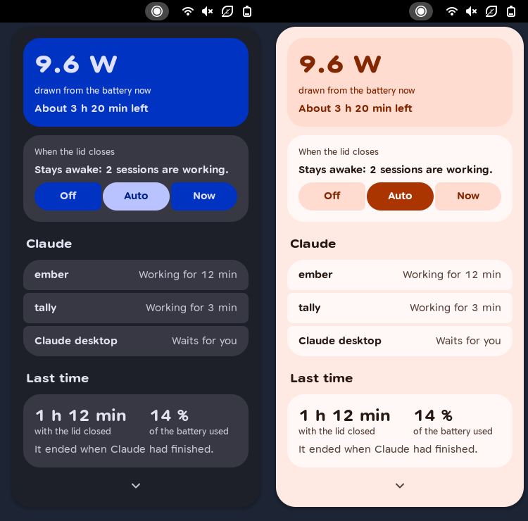
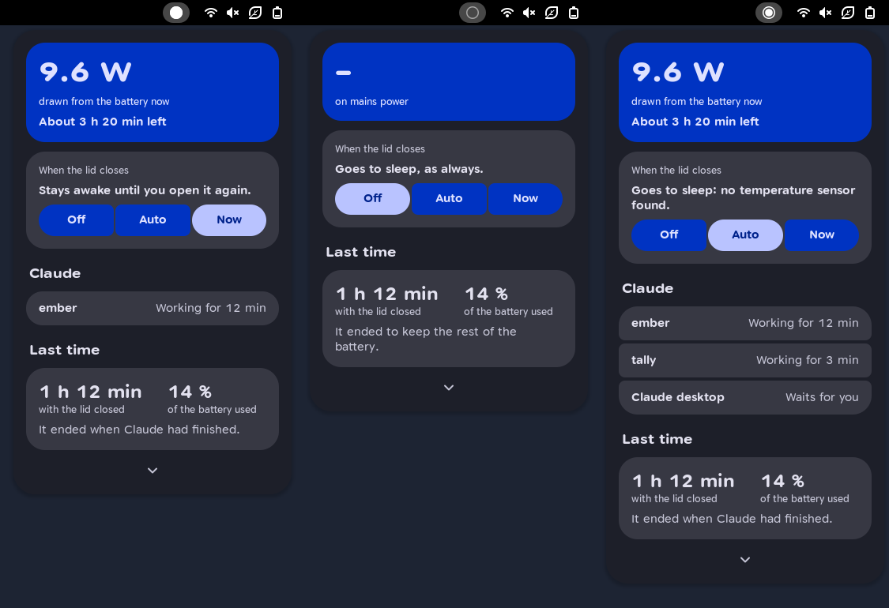
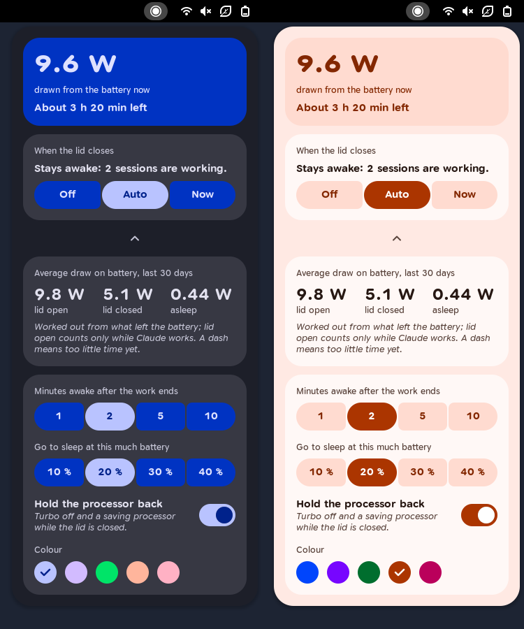
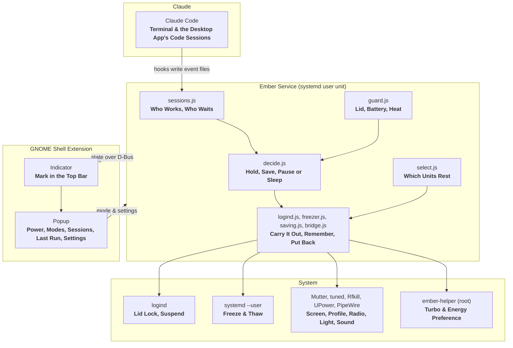
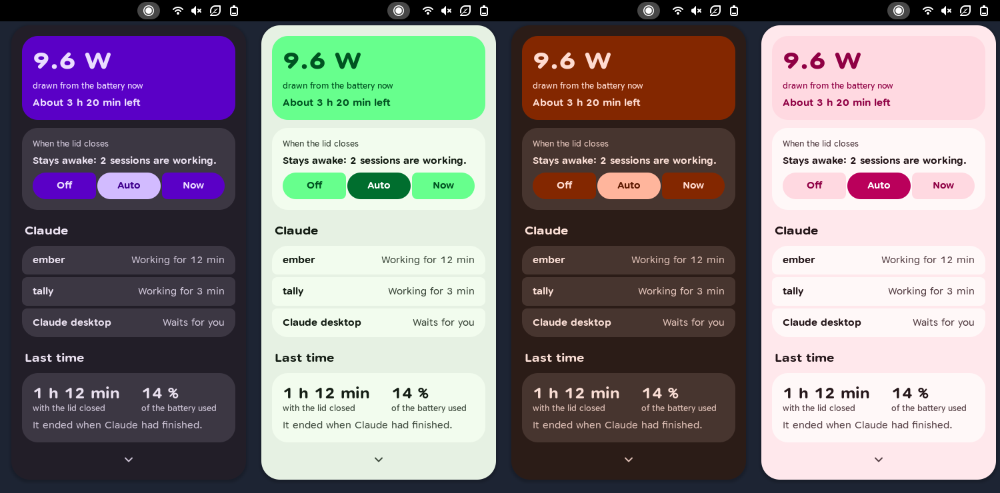

<div align="center">
  <h1>Ember</h1>
  <p><strong>Keeps Claude working with the laptop's lid closed: the screen off, every other program at rest, and the machine asleep as soon as the work is done.</strong></p>

  <p>
    
    
    
    
    
    
    
    
  </p>
</div>

---



A laptop with its lid closed sleeps, and whatever **Claude** was doing stops with it. **Ember** keeps the machine awake for exactly as long as a session of **Claude Code** works, in a terminal or in the **Claude desktop app**, and spends as little power as it can meanwhile: the session is locked, the screen is off, and every program that is not Claude is paused until the lid opens.

It consists of a small **service** that does the work and a **GNOME Shell extension** that shows and switches it. Ember opens no connection and reads no sign-in. There is no account, no server and no analytics.

Ember is an independent project. It is not made, endorsed or supported by **Anthropic**; Claude and Claude Code are Anthropic's names for its own products.

The screenshots on this page show sample data.

---

## Features

- **Three Modes:** **Off** leaves the lid alone. **Auto** keeps the machine awake only while Claude works. **Now** keeps it awake at the next closing of the lid, whatever runs, until the lid opens again; then the mode before it applies again.
- **Screen Off, Session Locked:** Closing the lid locks the session as it always does, and the screen is switched off.
- **Only Claude Goes On:** Every other program and the background services nobody needs without a screen are **frozen** and continue where they were when the lid opens. Nothing is closed.
- **Saving Power:** The **tuned** profile `powersave`, **Bluetooth** off, the **keyboard light** off, the **sound** muted, and with the helper **turbo** off. Everything is put back the way it was found.
- **Asleep When Done:** After the last session ends the machine stays awake for **2 minutes**, in case the work goes on, and then sleeps.
- **Waiting for You:** A session that asks for permission or an answer keeps the machine awake for **10 minutes**, so the answer can come from another device.
- **Battery Floor:** At **20 %** the machine sleeps, whatever is running.
- **Heat:** At **85 °C** the sessions themselves pause until the processor is back at **70 °C**. At **95 °C** the machine sleeps. On a machine whose processor shows no temperature Ember holds nothing, and says so.
- **A Record of the Draw:** One line a minute while the lid is closed and one every five while it is open, with the battery's energy, the power and the temperature. Before a sleep and after it one line each, so what the sleep cost can be told without waking the machine for it. The averages for **lid open**, **lid closed** and **asleep** stand in the menu behind the chevron.
- **A Look on Hover:** Resting the pointer on the top bar item shows the menu for as long as it stays there; a click holds it open.
- **A Report:** When the lid opens, one notification says how long it was closed, how much of the battery that used and why it ended.
- **Five Colour Styles:** **Blue**, **violet**, **green**, **orange** and **pink**, each in light and dark, following the system's colour scheme.
- **Safe to Fail:** The lock on the lid belongs to the service's process and goes with it. What was frozen or switched is written down first and put back when the service starts or stops.
- **A Restart Is Not the End:** While the lid is closed a second holder runs beside the service and keeps the lid for one more minute when the service ends. A service that is restarted or that crashed takes up the sessions where the last one left them; one that does not come back lets the machine sleep after that minute.

---

## The Menu

The mark in the top bar is a ring with a core: no core while Ember is off, a small one while it watches, a larger one while it holds the lid, and the whole ring for **Now**.

| Action on the top bar item | Result |
| :--- | :--- |
| **Rest the pointer** on it for 0.3 s | The menu appears until the pointer leaves. Nothing in it can be clicked meanwhile |
| **Click** | The menu is held open and can be used; a click outside or **Esc** closes it |

### Power

The one loud tile shows the power going out of the battery in **watts**, as the battery reports it, and the time that is left. Some batteries report no power between two readings; the tile then shows a dash.

### When the Lid Closes

One sentence says what closing the lid would do right now, above the three modes **Off**, **Auto** and **Now**.

### Claude

The sessions that work or wait, each with its project and for how long.

### Last Time

How long the lid was last closed with Ember holding it, how much of the battery that used, and why it ended.



### Average Draw

Behind the chevron, above the settings: what the machine drew on battery over the last 30 days with the **lid open** while Claude worked, with the **lid closed**, and **asleep**. The numbers come from what left the battery between two lines of the record, not from the power the battery reports. A dash means less than 3 minutes of such time on battery so far.

### Settings

Behind the chevron, where they take the place of the sessions and the last run:

- **Minutes Awake After the Work Ends:** **1**, **2**, **5** or **10**.
- **Battery Floor:** **10**, **20**, **30** or **40 %**.
- **Hold the Processor Back:** Turbo off and a saving processor while the lid is closed. Needs the root helper.
- **Colour:** One of the five styles.



---

## How Ember Knows That Claude Works

| Where Claude runs | Sign | Set up by |
| :--- | :--- | :--- |
| **Claude Code** in a terminal | Hooks: a prompt or a tool call means work, a notice means waiting, **Stop** means done | `install.sh` extends **`~/.claude/settings.json`**, after asking |
| **Code** sessions of the desktop app | The same hooks | The same |
| **Chat** and **Cowork** in the desktop app | None. Use **Now** for these | |

- **An End That Is Not Announced:** Claude Code sends no **Stop** when it is interrupted. A session with no hook event, no line added to its transcript and an idle processor for **10 minutes** counts as finished. For a session of the desktop app the processor is left out, because it shares its unit with the app.
- **Why Not the App's Own Sign:** The desktop app asks GNOME to hold off suspend, but it kept doing so for 12 minutes without any work (seen on 2026-10-13), so it says nothing about work.
- **Work in the Background:** A session that has stopped but whose terminal tab still uses the processor, such as a build it left running, counts as working.
- **A Closed Tab:** A session whose unit is gone is gone.

---

## What Rests and What Runs

| Runs on | Rests |
| :--- | :--- |
| Units that hold a **Claude** process, with everything started from them | Every other **app** and **terminal tab** |
| **Terminals**, which hold the sessions' output | **Evolution**'s services, **GNOME Software**, the file indexer |
| **Podman** containers | |
| The session itself: shell, D-Bus, keyring, SSH agent, file access, sound | |

Freezing uses the **cgroup freezer** through the user's own **systemd**; no root is needed. A program Claude calls that needs one of the resting programs waits until the lid opens.

Resting means everything: **music**, **downloads**, a **call** and the window of a **VPN** app stop with the rest and go on when the lid opens.

---

## What Leaves the Machine

Nothing. Ember makes no network request and has no account.

- **What the Hooks Write:** For each event four fields of what Claude Code hands a hook: the **session's id**, the **event's name**, the **working directory** and the **path of the transcript**, with the time and the control group. Prompts, commands and their output are not written.
- **Where It Goes:** A file in **`$XDG_RUNTIME_DIR/ember/events/`**, which only the user can read and which is gone after a restart. The service reads the file and deletes it.
- **What the Service Notes for a Restart:** The same four fields for each session it knows, in **`$XDG_RUNTIME_DIR/ember/sessions.json`**, gone with the next restart of the machine.
- **What Stays:** The record of the draw and one line per run, in **`~/.local/state/ember/`**. Neither names a project.

---

## Getting Started

You need **GNOME Shell 50** on **Wayland**, **systemd**, **Claude Code** or the **Claude desktop app**, and **jq** for the hooks. **tuned** is used when it is there.

**1. Clone:**
```bash
git clone https://github.com/tomsliikee/ember.git
```

**2. Install:**
```bash
./ember/install.sh
```

**3. Log out and back in.** GNOME Shell on Wayland loads a new extension only at login. The service runs at once.

**4. Optional, for turbo off while the lid is closed:**
```bash
sudo ./ember/install-helper.sh
```

The script links the repository to **`~/.local/share/ember`** and the extension into **`~/.local/share/gnome-shell/extensions`**, installs **Google Sans Flex** when the machine has none, installs and starts the user service, and asks before it adds the hooks to **`~/.claude/settings.json`**. The previous settings are kept beside the file as **`settings.json.before-ember`**. Keep the clone where it is: the links point into it.

To update, `git pull`, restart the service with `systemctl --user restart ember`, and log in again.

**Remove it again:**
```bash
./install.sh --remove
```

**Try it without closing the lid.** A dry run changes nothing and says what it would do; the file stands in for the lid:
```bash
echo open > /tmp/lid
gjs -m daemon/main.js --dry-run --lid-file /tmp/lid
```
```bash
echo closed > /tmp/lid
```

**See what the record adds up to:**
```bash
gjs -m tools/usage.js
```

**Run the checks:**
```bash
for t in tests/*.test.js; do gjs -m "$t"; done
```

**Render the menu** in a headless shell; the screenshots land in `$EMBER_OUT/shots`:
```bash
tools/headless/run.sh gallery
```

**Regenerate the stylesheet** after changing the template or the design tokens:
```bash
node tools/build-tokens.js
```

The styles in **`tools/styles.json`** only change when a seed does. **`tools/derive-styles`** derives them again; it needs **Dart** and the `material_color_utilities` package, both part of a **Flutter** installation.

---

## How It Works

Three parts: **pure logic** that decides and is covered by **78** unit tests, a **service** that carries the decisions out, and a **menu** drawn with **St** and **Cairo**.



- **One Place Decides:** `decide.js` gets the mode, the lid, the sessions, the battery and the temperature, and answers with what to do. It touches nothing, which is why every rule on this page has a test.
- **The Service Carries It Out:** Each change to the system goes through one function that also writes it to the journal; in a dry run it only writes.
- **The Extension Only Shows:** It reads one property from the service and calls two methods. With the screen locked GNOME switches extensions off; the service goes on.

### Data Storage & Disk Paths

| Path | Purpose |
| :--- | :--- |
| **`~/.config/ember/settings.json`** | Mode, grace period, battery floor, processor switch, colour style |
| **`~/.local/state/ember/runs.jsonl`** | One line per closed-lid run |
| **`~/.local/state/ember/usage.csv`** | The record of the draw, 30 days |
| **`~/.local/state/ember/applied.json`** | What is frozen or switched right now, to be put back |
| **`$XDG_RUNTIME_DIR/ember/events/`** | Hook events on their way to the service |
| **`$XDG_RUNTIME_DIR/ember/sessions.json`** | The sessions the service knows, for the service that follows a restart |
| **`$XDG_RUNTIME_DIR/ember/alive`** | The service's sign of life while the lid is closed; the bridge ends a minute after the last one |
| **`~/.claude/settings.json`** | Claude Code's settings; `install.sh` adds the hooks there, after asking |
| **`/usr/local/libexec/ember-helper`** | The root helper, if installed |

### The Root Helper

`ember-helper` takes one of two words, `save` and `restore`, and writes fixed values to fixed files: **`intel_pstate/no_turbo`** and each core's **`energy_performance_preference`**. Nothing a caller passes ends up in a path or a value. The service calls it through **pkexec**. The policy allows that without a password for every program of the user who sits at the machine, not for Ember alone; what such a program can reach through it is these two values.

---

## Look and Feel

The interface is built with **Toms Expressive Design**, the design system in **`toms-expressive-design/`**, the same as **Tally** and **Ledge**.

- **One Loud Thing:** The power draw is the only tile in the accent container; everything else is neutral.
- **Numbers Lead:** A large number, a quiet label that says what it is, and at most one sentence beside it.
- **Colour From One Seed:** Each of the five styles is a whole colour scheme derived from one seed colour, in light and dark.
- **Generated, Not Typed:** `tools/build-tokens.js` writes the stylesheet and the colour values from **`toms-expressive-design/tokens.json`**.
- **Google Sans Flex:** The design system's typeface, shipped with the repository.



---

## Limits

- **Intel Only for the Helper:** Turbo is switched through **`intel_pstate`**. On other processors the helper only sets the energy preference where the file exists.
- **Chat and Cowork Are Not Seen:** Only sessions of Claude Code report their work. For a chat, choose **Now** before closing the lid.
- **A Long Silent Wait:** A session that waits ten minutes inside one command, without using the processor, counts as finished. In the desktop app that holds for any command that runs ten minutes without output.
- **No Sensor, No Holding:** The heat rules need the processor's temperature, from **coretemp**, **k10temp**, **zenpower** or a thermal zone. Where none of them exists Ember leaves the lid alone in every mode.
- **Everything Else Stops:** What rests is chosen by the kind of unit, not by what the program does. There is no list of exceptions yet.
- **Not for a Bag:** A working laptop with its lid closed gets warm. The heat rules are always on, but a closed bag is not a place for it.
- **GNOME Only:** The lock, the screen and Bluetooth go through GNOME's own services.

---

## Platform Support Matrix

| Platform | Status |
| :--- | :--- |
| **GNOME Shell 50** on **Wayland** (Fedora 44), **Intel** | ***Tested*** on one laptop, an HP EliteBook 840 G5, and in a headless shell |
| The same on **AMD** | ***Built***: the sensor is chosen by a tested rule, the helper sets only the energy preference; no such machine was at hand |
| Other GNOME Shell versions | ***Planned***: `metadata.json` names version 50 only |
| Other desktops | Not planned: the lock, the screen and Bluetooth go through GNOME's own services |

Ember was written on 2026-10-12 and first run with a real lid on 2026-10-13.

| Part | State | How |
| :--- | :--- | :--- |
| **Decisions, session tracking, choice of units and of the sensor, the record's sums, texts** | *tested* | 78 unit tests |
| **Service, end to end** | *tested* | A dry run with a file standing in for the lid: closing, opening, **Now**, **Off** |
| **Freezing and thawing, putting back after a crash** | *tested* | On a throwaway unit |
| **Holding the lid from a user service** | *tested* | The lock appears in `systemd-inhibit --list` and goes with the process |
| **Hooks in Claude Code** | *tested* | Sessions in a terminal and in the desktop app's Code tab are seen working and stopping |
| **A real closed lid** | *tested* | On 2026-10-13: 24 commands ran through under a closed lid; after a second task the machine slept 2.5 minutes after its end, and again with the desktop app open, 2 minutes after the end |
| **Menu, light and dark, five styles** | *tested* | Rendered in a headless GNOME Shell 50.5 with sample states, also with Tally loaded beside it |
| **Look on hover** | *tested* | A virtual pointer in the headless shell: nothing when crossing, the menu after resting, gone on leaving, held by a click, no look after closing with a click on the item. Not tried in a real session |
| **A restart of the service** | *tested* in parts | With the lid open: the restarted service knew the working session at once and held the lid again; the bridge appeared in `systemd-inhibit --list`, ended on request and ended by itself 65 s after the last sign of life. A restart under a closed lid was not tried |
| **Root helper** | *tested* | Called and undone in three runs, by the journal; the processor's files were not read back |
| **Record of the draw** | *tested* | The sums by unit tests, the first lines in the file on the laptop. The lines around a sleep and an average from real readings were not seen |
| **Installing without existing Claude settings** | *tested* | Only the step that writes the hooks, on an empty file |
| **Screen off, battery floor, heat** | *built* | Not seen happening |
| **No sensor** | *built* | The rule and the sentence are unit tested; the laptop has a sensor |
| **Power saved** | *not measured* | The record is there to tell |

The extension reads no private part of GNOME Shell besides the place of the system menu in the top bar. The look on hover takes the menu out of the panel's menu manager for as long as it lasts, which is not a public interface and may change with a new version.

---

## License

**Ember** is released under the [**MIT License**](LICENSE).

The font in **`toms-expressive-design/fonts`**, **Google Sans Flex**, is the work of the Google Sans Flex Authors and comes under the **SIL Open Font License 1.1**; its text is in [`toms-expressive-design/fonts/OFL.txt`](toms-expressive-design/fonts/OFL.txt).
